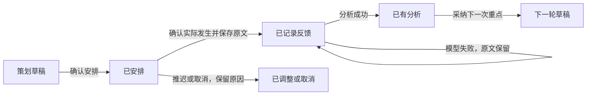

# 商机推进：跟进策划、拜访准备与反馈闭环

状态：V1 交互设计，待页面评审。2026-11-11。已制作本地交互原型，尚未接入业务保存与模型调用。

产品依据：20-specs/20-capability-domains.md D4、D6、D8，ADR-003、ADR-018、ADR-024。

## 入口与名称建议

保留「商机管理」作为模块入口，在其内部建设「商机推进」工作区。跟进策划、沟通策略、
反馈分析及下次拜访重点，都围绕同一商机、同一阶段目标展开，适合作为连续工作流。
单独建立顶层「跟进分析」会使拜访前后切换模块，也会把策划与行动弱化成看报表。

第一阶段基于现有商机清单和商机详情建设单笔工作台；不先替换商机管理列表，也不另建顶层模块。
单笔闭环成立后，再增加个人/团队跟进总览，按待跟进、待反馈和明确协同请求组织待办。
这属于现有商机模块的内部导航，不增加能力分区，不改变跟进证据和建议的拥有域。
本轮不改名；工作流完整落地后再评估是否将入口改为「商机推进」，避免仅改名称却仍是清单。

### 现有页面上的入口分工（2026-11-11 评审修订）

商机清单的表格与卡片保持现有结构。商机名称本身可点击，进入现有 `/pipeline/:id` 详情，
默认显示「商机分析」。标题常态正文色，hover/focus 使用 DS 品牌强调文字色；保持字号、
字重和行高，不缩放、不加下划线。客户副标题仍进入客户详情，使用同一悬停反馈方式。

原「打开阵地」与标题目前指向同一详情。正式工作台接入后，将这一操作替换为
「打开工作台」，进入 `/pipeline/:id?view=progress`，默认定位当前待处理环节；不在一行里
并列两个相近的打开按钮。新视图尚未接入前，现有操作保留原名称和目标。

单笔详情新增「商机分析 / 跟进推进」内部切换，沿用现有独立三栏：左栏复用商机档案、
决策分析、方案和客户资料；主区的分析视图保留态势判决、五维分析和交易清单，推进视图
组织策划、准备、反馈与记录；右栏复用本单助手、会前包、预演和下一步建议，并随环节调整上下文。

本地原型展示的是流程探索稿，当前独立工作台首页不作为第一阶段替换现有商机管理页的方案。
后续原型应先嵌入现有单笔详情结构，再评审总览；现有事实、原文与承诺不维护第二份副本。

## 当前基础与缺口

| 能力 | 已有实现 | 后续需要 |
| --- | --- | --- |
| 跟进策划 | 商机阶段退出标准、推进计划、下一步最佳动作建议 | 将目标、对象、动作、责任人、时间和验收证据组成一份可回看的计划 |
| 拜访准备 | `pipeline/meeting-pack-action.ts` 的会前包：选择参与人、阶段目标、未完成承诺；模型议程、逐人沟通、异议及问题 | 与本次计划关联，明确这次必须拿到什么，不只生成一段话 |
| 跟进策略 | 右侧局势简报、本单问答、沟通预演、关键人和竞争信息 | 按决策角色、立场、阻力给出策略及其依据，区分事实与推断 |
| 反馈分析 | 本单跟进原文、引用、证据抽取、互动热度 | 对照本次计划比较已达成、未达成和未知；说明买方回应、风险变化和缺失证据 |
| 下次拜访重点 | 下一步最佳动作、待兑现承诺、阶段缺口 | 从反馈推导下次对象、目标、问题及需要确认的事实，经用户确认纳入下一次计划 |

当前实现入口在商机详情的中心内容和右侧助手之间分散，不能把上述基础描述成已完成的闭环。
相关代码：`pipeline/[id]/page.tsx`、`@deck/pipeline/[id]/page.tsx`、
`components/deal-meeting.tsx`、`pipeline/next-action-action.ts`。

## 单笔商机工作区

上方保留商机名称、客户、阶段和主要目标。主内容用「策划 → 准备 → 反馈」任务顺序组织，
不堆成多个彼此独立的卡片；跟进记录作为共用证据随时可查。

1. **跟进策划**：本次要推进的阶段条件、拟联系的人、目标结果、动作和时间。每项策略说明
   来源：阶段规则、原始跟进或模型推断。缺信息时明确列出要问的问题。
2. **拜访准备**：选择实际参与人，带出角色与立场；生成会议议程、逐人沟通重点、异议应对
   和必须确认的问题。复用现有会前包与预演，不再建设另一套生成入口。
3. **反馈分析**：先记录实际沟通，再对照本次目标分析结果；逐条展示可点击原文依据，
   分清已证实、推测和未知。给出下次拜访重点，用户确认后转成下一次策划。

「互动热度」保留为评估维度，只展示指标与证据摘要，完整跟进记录进入共同证据区，
避免同一记录在多个板块重复展示和维护。右栏助手对准当前商机及当前任务，保留咨询、
补充追问和建议裁决；策划及反馈结果进入主内容，不能只藏在聊天历史里。

## 数据与权限边界

- 跟进原文仍归 D4 的 `yucer_field.interaction`；按商机关联，不复制成另一套记录。
- 阶段和商机联系人角色归 D6；建议和模型输出走 D8，沿用两道门。
- 核实后的实现事实：现有 `plan_step` 通过 `copilot/executor.ts` 的 `addCommitmentAction`
  生成 D4 承诺，并没有独立的 D6 跟进计划实体。页面上称为推进计划，不代表数据归属变了。
  新的内部行动不能无条件复用该执行器，否则安排一次拜访也会进入承诺达成口径。
- 反馈不自动认定阶段已达标、承诺已完成或胜率已提升；变更走各自既有校验和授权。
- 没有记录、记录过旧、证据冲突和无权限分别表达，不能以空数据推断客户态度。
- 本次计划与实际结果要可追溯；持久化的计划—拜访—反馈关联及版本需单独设计，
  不将会话文字冒充正式计划，不在本轮引入数据库字段或商业能力键。

## 建议实施顺序与验收

第一步整合已有会前包、推进计划、本单预演和记录入口，减少跳转与重复。第二步设计
本次计划、实际反馈和下一步建议的关联、保存与版本，再实现目标对照分析。第三步形成
个人跟进工作台，并在权限和数据完整的前提下补团队视角。

验收应覆盖有充分记录、只有少量记录、证据冲突、无权限四类。成功标准是销售能在同一
商机内完成「定目标 → 准备拜访 → 记录结果 → 判断差距 → 确认下一步」，且每次分析的
依据能打开原文。演示数据集成通过与真实模型建议质量分开报告。

## V1 页面与导航设计

| 层级 | 名称与入口 | 主要任务 |
| --- | --- | --- |
| Launcher | 保留「商机管理」和推荐火焰 | 进入业务模块，不增加并列的跟进入口 |
| 列表层 | 沿用现有商机清单；后续再补跟进总览 | 点击商机标题查看详情；打开工作台进入本单跟进 |
| 单笔详情 | 商机分析 / 跟进推进 | 看局势与证据，或围绕一次跟进工作 |
| 推进内部 | 跟进策划 / 拜访准备 / 反馈分析 / 跟进记录 | 按实际工作环节切换，保留各自输入 |

建议正式路由为 `/pipeline?view=followups&scope=mine&queue=overdue`，单笔为
`/pipeline/:id?view=progress&step=plan&cycle=:cycleId`。查询条件、对象和跟进轮次可分享、
可返回，刷新保留上下文。旧 `/pipeline` 和 `/pipeline/:id` 保持既有默认视图与深链接。
这里是路由契约建议，原型没有伪造轮次 ID，也没有覆盖实际业务路由。

「商机分析」继续承载既有态势判决、五维评估、交易清单；「跟进推进」承载每次沟通的工作流。
不把原有分析全部复制进新视图。互动热度保留摘要，点记录定位同一条证据。

### 列表层：跟进工作台

标题只有一个「商机管理」，下方为内部视图切换。工具行使用 32px；内部切换和行操作使用
24px。标题下保留 DS 浅色虚线及内留白。统计是同一行的文字与数字，不再套四五张卡片。

主要布局顺序：内部视图 → 我的/团队范围与搜索 → 待办统计和队列筛选 → 行清单。
工作台默认打开本人范围，优先逾期、待反馈和临近的行动；日期筛选是行动到期区间，
与商机清单的签约周期分开，不把季度签约筛选误套到跟进上。

| 列 | 展示与交互 |
| --- | --- |
| 商机 / 客户 | 商机主标题、客户副标题。商机进入推进，客户进入客户详情 |
| 本次推进目标 | 一句可验证结果，不显示大段策略。团队模式附协同请求摘要 |
| 下一次动作 / 时间 | 动作和绝对日期；临近时增加今天/明天提示，悬停仍可读完整时间 |
| 负责人 | 个人视角省略重复的自己，团队视角显示并可筛选 |
| 进展 | 主状态加必要的逾期、阻塞标记；状态并非互斥统计分类 |
| 操作 | 根据状态提供策划、准备或补反馈，进入同一笔商机的对应轮次 |

本人/团队不是授权开关：团队范围必须由服务器已有成员和数据范围授权决定。
没有团队读取权的人不显示团队入口。团队数据中只统计本人有权查看的事项，
不从工作区总量推断不可读对象。默认排序为风险与到期时间，不能只按金额挤压临近任务。

「待反馈」必须有明确的“拜访已发生”事实或人工确认，不根据约定时间过去就认定拜访发生；
已安排未确认发生且超过时间的，提示“核实拜访情况”。“需协同”来自已提出的协同请求，
不因模型一句“建议找售前”就给负责人增加任务。

### 单笔：独立三栏与开放式内容

档案栏 / 业务主区 / 智能助手独立控制滚动、宽度和留白，复用当前工作区分栏刻度，
不再增加一层三栏共用的大卡片。主内容直接面对浏览器边缘的一侧留白 48px，与侧栏相邻的一侧 24px；两侧栏自身内边距 24px，窄屏按既有规则缩减。

| 区域 | 内容 |
| --- | --- |
| 左栏 | 商机名称、客户、阶段、金额、负责人、关键人；不新增模块菜单 |
| 主区上方 | 本次轮次、目标、计划状态；切换四个工作环节 |
| 主区下方 | 当前环节的表单、议程、目标对照和原文；开放式 Section 与浅虚线 |
| 右栏 | 锚定当前商机、轮次和环节的助手；查看依据、生成建议、问答与裁决 |

1280px 以下，助手进入抽屉，保留主区阅读宽度；1440px 以下，档案信息收为主区一行摘要，
详细资料可按需展开。表格允许自身水平滚动，页面不整体横向溢出。弹窗、原文抽屉和预演
使用 DS 原生控件；不另画按钮、输入框、标签或图标。标题图标在实际同屏范围内唯一。

### 环节一：跟进策划

首屏只要求四项：目标结果、沟通对象、计划时间、验收依据。负责人默认当前本人，
渠道沿用默认，可按需补充。不要求销售提前填写“情绪”“成效评分”等推断。
目标尽量引用本阶段缺少的退出条件；没有条件时允许手工目标，明确不能因此判定阶段可流转。

「生成策略草稿」引用既有原文、阶段要求、角色与立场提出建议；展示依据及生成时间，
用户可修改，采纳仅带入草稿。「确认安排」才建立正式计划。自动存草稿与确认安排是不同动作，
正式实现需要服务端持久化并回报保存失败；切换环节不能丢输入。

策略内容控制为：本次主攻目标、按对象的沟通顺序、阻力与应对、必须核实的问题。
不堆多份相似长文。原文引用在对应建议旁展开，不让用户必须去聊天历史找来源。

### 环节二：拜访准备

继承已确认的目标和参与人。展示参与人角色/立场、议程、逐人沟通重点、待兑现约定和
必须确认的问题；复用现有会前包。讨论敏感事实仍依既有数据权限呈现。

「沟通预演」打开专注抽屉，不跳出本单。未生成模型建议时保留事实包，显示具体原因。
拜访完成后进入“记录反馈”；推迟和取消各保留原计划与理由，不自动写“失败拜访”。

### 环节三：反馈分析

默认只要求原文，时间默认为现在，渠道沿用上次；实际参与人和明确约定可选。
先保存原文成功，再开始分析。保存成功、分析失败必须分开显示，重试不再新增一条原文。
系统提取的承诺、角色变化和阶段证据保持待确认，不能直接覆盖原文或写成买方的正式意见。

主结果以目标对照为核心：

| 字段 | 要求 |
| --- | --- |
| 原目标 | 使用确认安排时的版本，不用后来改写的目标回算 |
| 当前结果 | 已证实 / 部分证实 / 未达成 / 未知，缺证据与明确否定分开 |
| 原文依据 | 逐项引用原文 ID、摘句与发生时间，可以打开对应原文 |
| 差距与风险 | 事实变化和模型推断分开，标明还需确认什么 |
| 下次重点 | 目标、对象、建议时间、关键问题；带入新草稿后由用户确认 |

记录冲突时并列两条原文，不自行择一；记录不足时给出核实问题，不输出空泛的“持续跟进”。
「带入下一次策划」产生新轮次草稿，保存与上次反馈的关联，保留上次目标和结果。
模型输出失败不影响已保存的反馈和计划，刷新可恢复。

### 环节四：跟进记录

按发生时间展示原文与参与人，附该次计划、分析版本和后续轮次。默认简洁，点击展开完整
内容与证据来源。更正仍沿用追加更正；作者删除遵守已有依赖限制。不能把删除原文后的
模型结论继续当作有依据的事实。旧跟进允许无计划关联，并显示“未关联计划”，不要求补造历史。

## 状态与数据契约草案

分析是反馈之上的独立结果，不把“分析失败”算作销售跟进失败。逾期、需协同和证据冲突为
叠加标记；客户承诺的 fulfilled/missed 以及商机赢丢状态仍使用各自原有口径。

| 逻辑对象 | 必须记录的关联与约束 |
| --- | --- |
| 一次跟进轮次 | 工作区、商机、负责人、计划目标及验收条件、参与人、计划时间、状态 |
| 计划版本 | 原目标、修改人和时间；后续分析引用确认时版本，不能静默替换 |
| 事实关联 | 同工作区、客户、商机的既有 interaction ID；一条原文不重复存储 |
| 分析产物 | 输入计划版本、证据集合、生成时间、模型/规则来源、逐项目标结论 |
| 下一轮关联 | 来源轮次和分析版本；重复点击、请求重试不得生成多份相同新草稿 |
| 承诺关联 | 明确的承诺方向、原始依据、截止时间与决定人；内部拜访计划单独管理 |

此表是后续实现的逻辑契约，尚未创建表或改变拥有域。若增加持久化轮次，需先补产品规格、
所属域决定及 ADR，再依仓库 DDL、Prisma、列授权和真库测试的既有流程实现。
当前 `plan_step -> commitment` 继续维持现状；新闭环不得悄悄扩大或改变其统计口径。

## 个人与团队的差异

个人默认显示“今天先做什么”和每笔商机的待办，快速进入准备或补反馈。
负责人默认显示团队逾期、待反馈与协同请求；可按成员筛选、查看阻塞依据、记录辅导建议。
读取团队数据不自动获得代他人确认计划、裁决建议或兑现承诺的权限。
本阶段不引入拜访数量排名、模型自评分排名或无法解释的“跟进质量分”。

## 原型交付与评审范围

本地入口：`http://localhost:4060/progression-preview`。服务端限定 development 环境，
生产构建返回 404，不加入 Launcher。使用真实 DS 控件与演示夹具，不访问数据库、不调用
模型、不写业务数据；草稿只在本次页面会话中保存，刷新重置。顶部明确标识“交互设计稿”。

可演示：个人/团队范围、队列筛选、搜索、进入商机、策划草稿、确认安排、准备、沟通预演、
原文反馈、固定示例分析、查看引用、建立下一轮草稿及回看记录。侧栏可切换记录不足、冲突、
无分析权限、助手不可用，评审这些情形如何退化。仅内置示例原文且匹配原始确认目标时展示固定分析；自定义原文仍可保留，但不会生成虚假的分析结果，不作为模型评测。

原型聚焦新增工作台与推进视图，不重建原有商机概览，也不替代真实权限演练。
商业档位、正式持久化结构、团队协同写权限及迁移规则在页面评审后进入实现设计，
不能据此原型宣称业务闭环已经上线。

本轮本地检查：应用类型检查、13 项字典/DS 字体/标签检查通过；浏览器走通个人与团队队列、搜索、策划到下一轮闭环及原文引用，390/700/1024/1280/1440/1600px 无页面横向溢出。未接入真实模型与权限服务。
