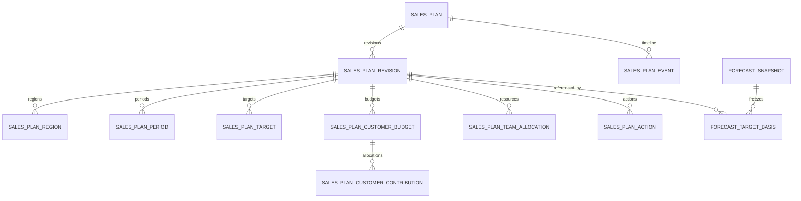

# 区域销售规划：对象模型、整版发布与历史口径

状态：首期 DDL、Prisma、服务与 DS 界面已实现；发布证据见实施计划。2026-11-11。

产品权威：[35-sales-planning](../20-specs/35-sales-planning.md)。
架构决定：[ADR-038](decisions/ADR-038-sales-planning-releases-a-whole-version.md)。
地域来源与客户选择项的基础修正见 PR #623；该 PR 不包含本文件的版本功能。

## 1. 聚合根与数据归属

销售规划是 D2 的聚合根。首期一个工作区、一个年度对应一份稳定计划；年份标签只是显示，
身份采用明确的周期边界及日历。区域、季度/月度都在同一修订下，不分别持有「最新版」。
D1 strategy_plan 是战略来源；现有 sales_target.plan_id 的含义保持为该 D1 对象。

| 领域 | 拥有对象 | 其他领域怎样使用 |
| --- | --- | --- |
| D2 | 规划、修订、目标档位/分解、客户贡献预算、资源与行动安排、版本事件 | 通过服务读取不可变版本或明确的草稿 |
| D4 | 客户、客户级别、客户经营计划；配置中的地理划分 | D2 读引用及当时的来源快照，不改客户资料和客户经营计划 |
| D2 组织能力 | 部门、成员分工和地理区域关系 | 规划读取组织资料；周期投入是规划内容，不反写组织成员关系 |
| D6 | 商机、实际归属、预测快照、提交时使用的目标依据 | D2 只读业绩；D6 只读规划版本，提交时冻结引用 |
| D8 | 规划建议和采纳记录 | 通过既有提案及具名决定调用 D2；不能直接写规划表或隐式发布 |

所有新产品表携带 workspace_id。跨对象引用需校验工作区，不以猜测名称或客户端传来的
UUID 授予访问。非同域资料由应用编排调用拥有域服务读取，store 不跨域写表。

## 2. 拟新增的 D2 关系

以下是实施时的模型契约，不是已存在的表清单；正式 DDL 增量编号在实施 PR 分配。

| 表 | 关键字段与职责 |
| --- | --- |
| sales_plan | id、workspace_id、plan_no、name、period_kind、period_start/end、calendar_key、time_zone、strategy_plan_id；稳定身份及并发锁点 |
| sales_plan_revision | id、plan_id、base_revision_id、restores_revision_id、state、edit_token、version_no、schema_version、created_by/at、sealed_by/at、change_reason、content_hash；共享草稿或完整冻结内容 |
| sales_plan_period | revision_id、period_key、parent_period_key、label、start/end；年度/季度/月度树，根与规划周期一致 |
| sales_plan_region | revision_id、territory_id、source_division_ref、code/name/geometry_snapshot、participation、exclusion_reason、owner_sub；纳入范围与地理边界快照 |
| sales_plan_target | revision_id、line_key、scope_key、period_key、metric、currency、floor_amount、target_amount、stretch_amount、assumptions；一条目标的三个档位 |
| sales_plan_customer_budget | revision_id、account_id、period_key、metric、currency、budget_amount、source_account_plan_ref、source_snapshot/read_at、basis_note；同一客户跨区贡献的总预算 |
| sales_plan_customer_contribution | revision_id、budget_id、territory_id、target_line_key、responsibility、contribution_amount、rationale；客户总预算向区域分配，主责和协同分开 |
| sales_plan_team_allocation | revision_id、allocation_key、territory_id、kind、source_unit_ref、member_sub、role_code、start/end、allocation_pct、requested_fte、source_snapshot；已落实成员与未补齐资源需求 |
| sales_plan_action | revision_id、action_key、territory_id、target_line_key、account_ref、objective、owner_sub、due_at、planned_evidence_refs；计划内容及跨版本稳定行动标识 |
| sales_plan_event | plan_id、event_no、kind、revision_ref、effective_at、related_event_ref、period_key、actor_sub、reason、recorded_at、request_key；发布/取消调度/子周期锁定/整期结案，只追加 |
| sales_plan_legacy_target | plan_id、legacy_target_id、legacy_snapshot、adopted_revision_id、adopted_by/at；显式接管旧目标、保留旧 ID 及接管依据 |

### 身份与字段约束

- plan_no、计划周期边界、工作区是身份，不能通过编辑草稿换成另一年度；复制到下一年度创建
  新计划，并标记来源。首期只创建年度根，历史独立季度目标先保留，不能与年度子季度争夺权威。
- revision.state 为 draft / sealed / abandoned；sealed 的全部内容及发布元数据冻结。
  「待生效 / 生效中 / 已替代 / 发布已取消」从事件推导，不是可任意更新的内容状态。
- 每根最多一个 draft（部分唯一索引），version_no 在根内唯一且只对 sealed 分配。
  edit_token 是草稿并发标记，与给用户展示的 V1/V2 业务版本号分开。
- line_key、action_key、allocation_key 在复制修订时保持稳定；对应周期、指标或对象身份
  改变时生成新键。逐版行 ID 不作为跨版本比较键，禁止按名称或行位置猜测对应关系。
- target.scope_key 首期为 workspace 或 territory:<稳定 territory ID>。个人配额仍是独立
  作用域；如果展示为资源分工的辅助参考，不加入公司/区域目标合计。
- 目标行唯一键覆盖 revision、scope、period、metric、currency。数量的 currency=NULL，
  唯一约束必须按 NULLS NOT DISTINCT 或等价部分索引实施，不能依赖默认 NULL 唯一行为。
- 金额使用精确 Decimal 与最小货币单位，禁止浮点误差决定是否分配超额。新客为整数。
  草稿可缺 target_amount；发布校验补齐主要目标，缺省档位不得被序列化为 0。
- 三档均校验非负与单调关系；未填中档的草稿若同时有保底和挑战，两者也不能倒置。
  货币与计数单位继承现有四项指标定义，不以新字段另造一套单位权威。
- 版本事件按根内 event_no 排序，时间戳不足以区分并发事件；请求幂等键在工作区/操作内
  唯一，并保存请求摘要，同键异内容拒绝，不能把另一次请求误认成成功重试。

### 主数据与快照的引用策略

区域使用仍被历史目标、商机引用的稳定 territory ID，不把 market_division ID 替代进旧
外键。source_division_ref 加上完整地域快照解释当时采用的配置；源配置删除/重新划分不能
级联修改冻结版本。部门的 source_unit_ref 与当时名称也作为来源引用记录，组织重建不应
因冻结版本的外键阻止日常维护，或以 SET NULL 反过来修改冻结快照。

可删除的配置引用采用明确的历史来源标识及快照，发布时经拥有域服务校验，读时说明来源
已变更/停用。稳定身份引用使用工作区复合外键及 RESTRICT；客户若被正式规划引用，应纳入
已有「有业务依赖不能删除空壳」校验。成员 sub 保留历史身份，离职不使原计划人员消失。
所有快照有 schema_version、source_read_at，不能宣称跨域来源读取处于一个写事务内。

## 3. 指标、分配和资源校验

目标轴为「版本 × 范围 × 周期 × 指标 × 币种」，三档是同一行的属性，不能当三条业绩。
分配轴另分地域、时间、客户；分别算余额，界面标明是哪一种分配，禁止合计这些轴。

| 校验 | 规则与退化 |
| --- | --- |
| 地域分配 | 同周期、指标、币种、档位下，纳入区域合计 ≤ 公司目标；余额明确为待分配，发布须说明；公司目标缺失不能显示已全部分配 |
| 时间分解 | 子周期包含在父周期且同层不交叠；仅允许相加的指标检查子项合计 ≤ 父项；空档位使该档完整性未知 |
| 管道 | 保存观察口径，不把季度管道相加当年度管道，不以总开放金额替代既有 pipeline 分类金额 |
| 新客 | 规划分配数量可分解；真实新增客户按 D6 的工作区首次赢单口径去重，跨区客户不重复计新客 |
| 毛利 | 允许设目标；没有成本来源就保持不可测量，不借成交额充当毛利 |
| 客户贡献 | 同一预算跨区域去重后分配，总额 ≤ 客户预算；区域贡献合计 ≤ 对应区域正式目标；余额可以存在 |
| 客户来源 | account_plan 的 period/金额口径须匹配；不匹配则要求明确本周期贡献预算与依据，不自动把客户经营目标当作本区域收入 |
| 团队投入 | 按 member_sub 去重人员，按实际重叠日期检查区域分配；需求岗位不冒充已到位人员，超配是需确认的规划风险 |
| 跨权限来源 | 不能读取的客户/成员不当成不存在或贡献为零；完成发布必需的校验无法进行时阻止发布并说明缺失权限 |
| 执行进展 | 读取原跟进/商机/承诺事实并标观察时间；不通过修改冻结 action 行保存反馈 |

闭合的子周期按 period_key 记录根级锁定事件。新修订和最终发布都与最后生效版核对已锁定
子树的全部目标及支撑分配；复制旧版不免除此校验。移除子周期、改变日期边界也算修改。
年度金额低于已锁定可加部分合计时拒绝；仍开放季度可以调整其计划值并写明原因。
锁定针对已明确分配到该子周期的内容；未分解的年度客户预算不能按天数猜成季度贡献。
跨期人员投入按与关闭区间的交集核对，允许下一版拆行但不得改变关闭区间的身份及投入。
年度预算仍可调整，但不得小于已锁定的同口径分配，不能以修改父行绕过已关闭子周期。

## 4. 发布事务与时间线

### 草稿保存

服务先执行既有权益/权限/记录范围门控。请求必须携带 revision_id 与 expected_edit_token；
在同一事务更新草稿及子项并增加标记。标记不匹配返回 draft_conflict，并给出最新版本及
冲突对象；页面保留未保存输入，不能用最后写入覆盖同事修改。

复制当前生效版生成草稿时记住 base_revision_id；从历史恢复另记 restores_revision_id。
根在复制/保存期间发生发布、取消调度、周期结案等变化时，用预期 event_no 检测。

### 发布

1. 读取并校验拥有域提供的地域、客户预算和人员来源；保留明确来源读时点及内容。
2. D2 事务锁住 sales_plan 根及草稿，重新检查 workspace、edit_token、expected_event_no、
   base_revision_id 与发布权限；发现基线变化、根已结案或未经处理的待生效版本即拒绝。
3. 校验目标、分配、关闭周期锁、引用权限/完整性及调整说明。跨域来源采用本次明确校验过
   的快照；不能把它冒称为整个跨域事务提交时的最新资料。
4. 对规范化的完整内容计算 hash，分配 version_no，将草稿封为 sealed，追加 release 事件。
   调度替换如已明确选择，在此事务追加原调度取消事件和新 release，不能先取消后写失败。
5. 成功返回同一 revision ID 与版本号；失败回滚所有写入。重复同一幂等请求返回同一结果。

正式版本号以发布时间顺序递增，允许 V2 取消后下一次为 V3，不复用 V2。首次发布也可未来
生效，此时还没有当前生效版；首个真正生效且未取消的版本成为原始基线。

### 生效选择

读取 release / cancel 事件，按查看时点筛选有效发布，解析 effective_at 不晚于查看时点的
最新版本。取消只能发生在对应生效时间之前。首期只允许一个未来发布；已有未来发布时，
立即发布或替换未来发布必须显式取消旧调度，避免之后又被旧调度覆盖。

发布/取消/结案均在根锁下序列化。定时任务只做通知或缓存预热，读路径按事件解析生效，
任务停机不延迟业务切换。请求记录的 recorded_at 与 effective_at 均保留，事件号解决同刻
顺序；指定历史查询说明观察时点与已知事件截止，已提交历史报告优先采用其冻结的依据。

计划结案事务检查并废弃未发布草稿、取消未生效调度并追加 close 事件。关闭后的规划仍可
读取和比较，不能再发布或重开历史季度；历史错误采用独立更正记录和新解释，不能 UPDATE
原版本/原报告。详细历史更正工作流另立实施项，不提供泛化的强制覆盖接口。

## 5. D6 提交与历史达成

拟新增 D6 表 forecast_target_basis，字段包括 workspace_id、forecast_snapshot_id、metric、
source_kind（sales_plan / legacy / none）、sales_plan_revision_ref、target_line_key、
legacy_target_ref、target_snapshot、basis_resolved_at、schema_version。

- D2 通过 resolveTargetBasis 返回调用方实际有权读取的生效版本、指标及不可变金额，并说明
  原始基线和当前生效版本。无正式目标显式返回 none；真实读取失败不能退回旧目标或零值。
- 应用编排把该只读依据交给 D6 提交服务；D6 在自己的事务内同时插入预测快照和依据。
  多指标分别绑定，唯一键防重复；失败一并回滚，不制造有快照无依据的半次提交。
- 提交与规划发布并发时，保留本次实际解析到的 revision 和 basis_resolved_at。冻结后不再
  用「按时间找今天认为当时该用的目标」替代实际采用值，不承诺跨域写事务。
- 历史视图以该 binding 的正式目标档为分母、原 forecast snapshot 的指标值为分子；当前
  视图可按现行目标复算，并显式对照原始基线，二者名称、时点和版本号不同。
- 毛利、零目标、缺快照、币种冲突等沿用现有明确的不可测量状态。版本不使缺失数据变成零。
- 若地域边界、客户实际归属或指标定义变更，比较必须展示口径变化；D6 的历史金额不因
  规划调拨而迁移。旧部门范围不能直接当作新地理范围；存在唯一明确映射才可建议接管，
  存在歧义时保留未分配并要求确认。计划贡献分配不改实际商机归属。
- 已有无 binding 的 forecast_snapshot 保持原样并标为旧口径，显示当时缺少的目标版本记录。
  不追加一条虚假的 binding 声称历史提交者采用了后来才发布的 V1。

## 6. 数据库约束与读取权限

草稿的可编辑字段通过列级授权声明；业务身份不可更新。事件及 forecast_target_basis 只授
SELECT/INSERT。sealed 修订和子项的不可变性需行级触发器保护，不能只靠 TypeScript 分支。
子项 INSERT/UPDATE/DELETE 都必须锁定并核查所属 revision 为 draft，与发布锁形成互斥，
防止发布后的并发 INSERT 混入冻结版本。复制新版本使用新行，历史版本不做 CASCADE 改写。

跨行分配、子周期交叠、关闭子树以及单个未来调度等规则在发布事务内检查，并用适当的延迟
约束触发器/受控发布函数兜底；普通服务角色不能直接构造一条 sealed 修订绕过完整性检查。
新外键、唯一索引、CHECK、触发器及授权必须在真实 Postgres 中验证。DDL/Prisma/列锁镜像
按仓库三件套同步，不能先只加 Prisma 表。

发布复用 planning.write 与既有 planning.target / planning.territory 相关权益，不新增
feature key。版本读取至少需要 planning.read，且按有权管理的公司/区域范围读取；区域
操作者不能借「发布整份规划」改变无权管理区域，改动集逐项检查。对其他区域的必要汇总
由有权限的发布者或受限校验结果提供，不能把整份客户明细交给局部操作者。

复制、历史、差异、导出均重新检查当前权限。客户/成员快照的明细按其拥有域的数据范围
脱敏或隐藏；受保护内容不能通过旧名称、金额差异、隐藏条目数量泄漏。公开可读的公司
目标与不可见明细分开授权，不能由前端隐藏承担隔离。

## 7. 兼容和接管

新增结构先旁路部署，不改变现有销售目标作用域唯一键。旧目标的 plan_id 继续是 D1 战略
引用；D2 sales_plan_id 与 revision_id 使用独立字段/关系，绝不复用旧列。

首次采用新规划时，由维护者选择既有公司/地理区域目标并确认周期、指标、币种及范围。
旧金额作为正式目标档，保底/挑战保持缺省，不生成 80%/120% 的伪历史；旧独立季度数据
可作为时间分解来源，历史团队目标和未知周期不强制归入地理区域。

接管映射、冻结来源快照及首版发布同一 D2 事务完成。接管后旧目标调整入口返回
managed_by_sales_plan 并跳转新草稿；所有目标读取（规划、态势、承诺达成及助手）统一
经 resolveEffectiveTarget。已经接管的键若新目标读失败就报错，不能回退旧金额。
尚未接管的键继续走原服务；新旧分母不可同时汇总。发布回滚不靠把旧表再写回去。

前台仅在接管及读取路径一并就绪后切换。历史快照缺少基线仍按旧口径展示；关闭目标的
历史状态不解除、不移用 ID、不修改归因。可执行回滚策略需同时覆盖这些消费者及新写入，
不能仅回退 UI 后再次开放已接管旧目标编辑。

## 8. 界面承载

销售规划首页保持开放式布局，顶部集中年度、原始基线/当前/草稿版本选择与主要操作。
公司目标按年度指标使用 DS `MetricListCard`；收入三档只显示一次，同一组卡片补充同币种
区域已分配/待分配及去重成员/资源需求，不再重复成一张年度表格。

区域规划复用 DS `FilterBar`、`ListCardGrid`、`MetricListCard` 和 `DataTable` 的标准
卡片/列表视图及响应式断点，不自造区域卡片或切换下拉。卡片展示覆盖地域、年度三档和
客户/人员/行动摘要。公司及区域季度明细默认收起：卡片采用 DS `Collapsible` + `Button`，
列表使用 `DataTable` 展开行，明细复用同一季度表格；区域详情中的季度可编辑。

区域标题进入同一规划的区域详情，hover 改文字色，不加下划线。详情内部为目标、客户、
团队、行动及版本历史；复用客户详情与组织配置入口，不再创建一套客户/部门编辑器。
编辑、保存草稿、发布为不同动作，工具条沿用 DS 32px/24px 层级。

「规划检查」仅保留在页头的按钮和数量，点击打开 DS 中档 Drawer；检查条目可定位区域并
关闭抽屉，不占据主页面区块。金额输入无效导致检查暂不可用时明确提示，不声称检查通过。

规划假设按客户、产品、人员、服务四类前提逐条记录，提示填写依据、落实时间及未确认状态；
不自动生成或认定前提成立。各类采用 DS `PanelCard` 与双列 `FieldGroup`，通用前提跨整行；
分配说明和资源超配说明独立保留。为兼容已冻结版本及哈希，
分类条目以带 `@yucer/plan-prerequisites:v1` 前缀的结构化文本保存于原 `assumptions` 字段，
仍受 8000 字符总限额与整版保存规则约束，无 DDL/模型结构变更。原普通文本在「通用前提」
完整保留；仅在用户编辑后写入新草稿，未知格式回退为原文，不覆盖历史版本。差异页显示
分类名称与实际条目，不向用户展示序列化内容。

待生效版本与当前版同时出现时标明各自生效时间；差异支持按区域/目标/客户/资源筛选。
发布摘要列出变化、未分配金额和需确认风险，发布按钮具名明确；冲突或失败保留输入。
达成摘要跳转统一承诺达成工作区并携带确切周期、区域和目标版本，历史视图固定所选版本。

## 9. 首期物理结构与运维边界

第 2 节是概念对象清单。实际采用 ADR-038 所述的五表结构：周期、区域、目标、预算、
贡献、团队、行动合并为 sales_plan_revision.content 文档。稳定 key、引用完整性及发布
校验仍保留；没有可绕过 sealed 行锁的独立子表写入口。DDL 权威为 incr/0106，Prisma 与
列锁同步；迁移自身使用事务，失败不留下半套结构，正式部署只走 db-init 账本。

年度及季度在界面可编辑，月度暂只保留模型能力。人员、客户、区域来源重新授权读取；
完整版本仅供工作区范围访问，局部权限保留原视图。确定性规划检查与版本差异已提供；
专属模型建议、自动执行证据关联和历史更正工作流尚未交付。

### 回滚

增量不下撤。接管前可回退应用，既有 sales_target 保留。接管后，旧应用不理解新目标权威，
不能作为安全读回退；数据库会拒绝修改已接管目标，但无法让旧代码显示新版本值。
此时须前向修复或回退至支持该版本结构的镜像，不把旧金额写回旧表。业务回退使用
「基于此版恢复」生成新版本，锁定季度及年度结案仍生效；发布取消不删除历史。
生产先执行 pinned SHA 的 db-init，再发布同一 SHA 镜像。环境人工审批不可由 agent 代批。
